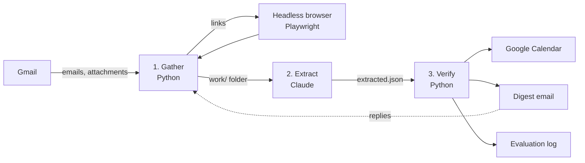

# School digest agent

Every Sunday, this agent reads a parent's school email, including the PDF
newsletters, image flyers and SchoolMessenger links that most tools skip. It
pulls out tests, deadlines and events, checks its own work, adds new events to
Google Calendar and emails a short digest of the week ahead.

It runs on GitHub Actions, so no computer has to be on, and it costs nothing to
run: GitHub Actions and the Google APIs are free at this volume, and the model
step uses an existing Claude subscription rather than a paid API key.

## Why

A school week arrives as dozens of emails from the district, two schools,
several teachers and the PTA. The important part is often not in the email at
all: it is in an attached PDF, a newsletter that is a single image, or a link to
a page that only renders in a browser. Missing one means missing a test, a
permission slip or an early dismissal.

## How it works



1. **Gather** (`digest/gather.py`). Searches Gmail for school senders and
   keywords. Saves each email's text, decodes attachments (text PDFs become
   text; scanned PDFs, flyers and images are kept as pictures), and opens
   school links in a headless browser, following any PDFs linked from those
   pages. It also collects the parent's replies to earlier digests.
2. **Extract** (`prompts/extract.md`). Claude reads everything, looks at the
   images, and writes structured JSON: who each item is for, what it is, when,
   what the parent must do, which sources it came from, and the exact words that
   state the date. It can only read and write files: no shell and no web access,
   because the input is untrusted email.
3. **Verify** (`digest/verify.py`). Deterministic checks before anything is
   sent:
   - items that cite no real source are dropped
   - the quoted date wording must actually appear in the cited source
   - a weekday that doesn't match the date ("Thursday, November 11" when the
     11th is a Wednesday) or a year that doesn't match is flagged
   - repeated reminders about the same event are merged
   - only clean, dated items go on the calendar; anything doubtful appears in the
     email under "Flags" instead
4. **Calendar and email** (`digest/calendar_sync.py`, `digest/render.py`).
   New events are added only when no similar event exists that day, including
   ones the parent made by hand. Existing events are never changed or deleted
   and no one is invited. The digest has sections for actions, tests, this
   week, coming up, things it couldn't read, and flags.
5. **Learn from replies.** The digest ends with "Reply with anything I missed or
   got wrong." Next week, those replies are read and applied, and the digest
   says what was corrected.

## Evaluation

Each weekly run appends one row of counts to [`evals/runs.csv`](evals/runs.csv).
No names, dates or email content are recorded. The columns that matter most:

| Metric | What it measures |
| --- | --- |
| `evidence_verified / evidence_checked` | How often the model's quoted date wording is really in the source (a hallucination check) |
| `items_dropped_unsourced` | Items the model proposed without a real source |
| `items_with_issues` | Items that failed a date check and were flagged instead of added |
| `attachments_unreadable`, `links_unreadable` | How much content the agent still can't open |
| `corrections_applied` | How often the parent had to correct a digest, a proxy for misses |

## Privacy

- The repository holds only code, docs and made-up example data
  ([`config.example.yaml`](config.example.yaml), [`tests/`](tests)).
- The real configuration (children's names, schools, grades) and all
  credentials are GitHub secrets.
- On a public repository the Actions log is public, so the code prints only
  counts, and the Claude step runs with its output hidden.
- Working files exist only on the temporary runner and are deleted at the end
  of each run. Nothing is uploaded as an artifact.

## Setup

You need a GitHub account, a Google account and a Claude Pro or Max
subscription.

1. **Claude token.** Install Claude Code, run `claude setup-token`, and save
   the token as the repository secret `CLAUDE_CODE_OAUTH_TOKEN`.
2. **Google access.** In Google Cloud Console, create a project, enable the
   Gmail API and Google Calendar API, configure the OAuth consent screen
   (External, add yourself as a test user, then publish it to "In production"
   so access doesn't expire after 7 days), and create an OAuth client of type
   "Desktop app". Run [`scripts/get_refresh_token.py`](scripts/get_refresh_token.py)
   and save the three values it prints as `GOOGLE_CLIENT_ID`,
   `GOOGLE_CLIENT_SECRET` and `GOOGLE_REFRESH_TOKEN`.
3. **Your configuration.** Copy [`config.example.yaml`](config.example.yaml),
   fill in your details and save the whole YAML as the secret `DIGEST_CONFIG`.
4. **Test run.** Under **Actions → Weekly school digest → Run workflow**, leave
   "Test run" checked. You'll get an email marked `[Test run]` and nothing is
   added to your calendar.

After that it runs every Sunday morning on its own.

## Development

```bash
pip install -r requirements.txt
pytest
```

The tests use made-up emails and need no Google or Claude access.

```
digest/
  gather.py         Gmail search, attachment decoding, link following
  documents.py      PDFs and images into readable text or pictures
  links.py          headless-browser page fetching
  verify.py         source, evidence and date checks; de-duplication
  calendar_sync.py  safe, idempotent calendar inserts
  render.py         the digest email
  send.py           verify, calendar, email, evaluation log
  evals.py          the evaluation log
prompts/extract.md  instructions for the extraction step
.github/workflows/weekly-digest.yml
```
